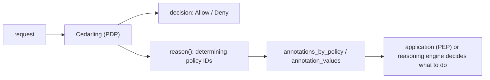

---
tags:
  - administration
  - lock
  - authorization / authz
  - Cedar
  - Cedarling
  - annotations
---

# Policy Annotation Patterns

A Cedar policy answers one question: is this action on this resource allowed, yes or no. That
answer alone is often not enough to build a product. When a request is denied, the application
wants to know *which* rule refused it, so it can explain the refusal, offer a way forward, or hand
the case to something that can. When a request is allowed, it may want to know *on what basis*,
because an allow under a break-glass rule is not the same event as an allow under a standing grant.

Cedar annotations (`@key("value")`) let the policy author label each policy with what it checks,
and Cedarling hands those labels back with the decision. The policy says what it found. The
application, or a reasoning engine behind it, decides what to do about it.

This section collects patterns for doing that. Each page describes a scenario, the policies, and
the application code that reads the annotations.

The code samples assume you know how an authorization request carries its principal, resource, and
context. If that is new, read [Authorization](../reference/cedarling-authz.md) and
[Entities](../reference/cedarling-entities.md) first; nothing here changes how a request is built.

!!! note "These are illustrative examples, not a specification"

    Cedarling gives annotations no built-in meaning. `@checks`, `@detail`, `@server_input`, and
    every other key on these pages were chosen for the documentation: they are not reserved, not
    validated, and nothing in Cedarling reacts to them. An annotation only does something because
    *your* application reads that key.

    The one exception is `@id`, which Cedarling uses as the policy ID.

    The same goes for the scenarios themselves. The companies, entities, schemas, and flows exist
    to show what the mechanism makes possible. They are deliberately simplified, and they are
    neither reference architectures nor security advice for your system. Design your own
    vocabulary and your own policies around your own risk model.

The pages build on each other, so read them in this order if the mechanism is new to you.

| Pattern | Problem it solves |
|---|---|
| [Quota and threshold warnings](./annotation-quota.md) | Telling the user they are close to a limit before it turns into a denial |
| [Multi-step flows and escalation](./annotation-workflow.md) | Onboarding prerequisites, approvals, and break-glass access |
| [Step-up and evidence](./annotation-challenge.md) | A denial that names what is missing, so a challenge service can collect it |
| [Shaping the response](./annotation-response-shaping.md) | Masking and limiting data according to the grant that matched |
| [Advisory denials in a client-side PDP](./annotation-client-authority.md) | Telling a browser which of its own denials rest on data it cannot see |

## Annotations Inform, the Application Decides

Every pattern here uses annotations in one way: to describe the policy. A policy says what condition
it tests, and nothing about what should happen next.

```cedar
@checks("quota.reports.exhausted")
```

That label is all the application needs. Its own table maps `quota.reports.exhausted` to a
translated message, an upgrade offer for a self-serve customer, a call to the account manager for an
enterprise one, and a reset date from the billing system. None of that belongs in the policy, for
three reasons:

- The right reaction depends on context the policy does not have: the customer's contract, the
  channel the request came from, other signals collected across applications.
- Remedies change at product speed. Message copy, upgrade offers, and escalation contacts would turn
  every product change into a policy release.
- A policy that instructs the application is a policy whose meaning depends on the application
  following it. A policy that describes itself stays true whoever reads it.

This matters most for step-up. Deciding which challenge to put in front of an accessor (a security
key touch, a confirmation from a human, an approval from a data owner) is an organization-level
decision, usually made by a reasoning engine or an identity orchestration service that weighs
signals no single policy sees. The policy contributes one input to that decision: the condition it
found. See [Step-up and evidence](./annotation-challenge.md).

### The Vocabulary Used on These Pages

| Key | Carries | Read by |
|---|---|---|
| `@checks` | the condition the policy tests, as a stable identifier: `onboarding.bank_account_missing`, `quota.reports.exhausted` | application code |
| `@detail` | one sentence for the developer explaining the condition: "The workspace has used its full monthly report quota." | logs and debugging tools, never end users |
| `@control`, `@regulation` | which compliance control or regulation the policy implements | auditors and compliance tooling |
| `@server_input` | the context field the policy reads that only the server holds fresh | a client-side PDP |

A `@checks` value names a state, not an action. `onboarding.bank_account_missing` stays accurate
whatever the application does about it; `onboarding.redirect_to_bank_form` would be a remedy
dressed up as a fact. Use dotted, lowercase identifiers, keep them stable once published, and treat
them like an API: renaming one breaks every application table that maps it.

`@detail` is for people debugging the system, which is why it can be plain English and does not need
a translation catalog. Text that end users read comes from the application's own catalog, keyed by
the `@checks` value.

## The Mental Model



Three properties follow from this, and every pattern in this section respects them.

The decision stays binary. An annotation never changes `Allow` into `Deny` or the reverse. A label
travels alongside a decision. It is never a third decision.

The policy describes and the application acts. `@checks("document.outside_operator_assignments")`
says what the policy found. Whether that leads to a request for owner approval, a refusal, or a
security alert is decided elsewhere.

Annotations are static. The value is a literal string fixed at authoring time. It cannot
include context, entity attributes, or the current counter value. Anything dynamic is resolved
by the application after it reads the label.

## Mechanics You Need to Know

These constraints shape how the patterns are written, so read them before designing an annotation
vocabulary.

### Only the Determining Policies Are Reported

`result.response.diagnostics().reason()` contains the policies that determined the outcome, and
those are the only policies whose annotations you can resolve. Cedar reaches a decision in three
ways, and each one reports something different:

| Outcome | How it happened | `reason()` contains | Annotations you can read |
|---|---|---|---|
| `Allow` | at least one `permit` matched, no `forbid` did | the satisfied `permit` policies | the annotations on those `permit` policies |
| `Deny` | a `forbid` matched, whether or not a `permit` also did | the satisfied `forbid` policies | the annotations on those `forbid` policies |
| `Deny` | nothing matched at all, the default deny | nothing, `reason()` is empty | none |

The two `Deny` rows are different situations, not conflicting statements about one. In the first, a
policy author wrote a rule that actively blocked the request, and that rule can describe itself. In
the second, no rule blocked anything and no rule allowed anything either: Cedar denies by default,
and a default has no policy behind it to carry an annotation.

`permit` annotations also never survive a `Deny`. When a `forbid` overrides a matching `permit`,
only the `forbid` appears in `reason()`, so a label on the `permit` is not available to explain the
denial.

A fourth case looks just like the third. A policy whose expression errors at evaluation time, on
integer overflow or on an attribute the entity does not carry, is dropped from the decision and
reported in `diagnostics().errors()` instead of `reason()`. If that policy was the only `permit`,
the result is a `Deny` with an empty `reason()`, which looks the same as "nothing matched" to code
that reads only `reason()`. Log `errors()` alongside the decision, or a broken policy looks like an
ordinary default deny for as long as nobody checks.

A fifth case fills `reason()` with policies that did not fire at all. `authorize_unsigned` with no
principal runs Cedar's partial evaluation, and when some policies remain undecided, Cedarling
returns a `Deny` whose `reason()` holds the IDs of those undecided policies. Those policies were
neither satisfied nor rejected: the request lacked what they needed to decide. Their labels describe
rules that might have applied, so treat a principal-less denial as "undetermined" rather than as the
reason for a refusal.

The default-deny row is the one people most often get wrong. If you want a label for a request that
simply matches no `permit`, an annotated `forbid` has to exist and match, as the quota example does
with its `forbid` at 100%. Otherwise, the application needs its own fallback for "denied, nothing
more to say". Do not add a catch-all `forbid` just to hang an annotation on it: in Cedar `forbid`
always wins, so a broad catch-all silently overrides every `permit` you have.

### One Key per Policy, Several Values Means Several Policies

Cedar rejects a duplicate annotation key on the same policy (`duplicate annotation: @checks`), so a
single policy carries at most one `@checks`. Two independent conditions are two policies, each
labeled, and both have to be satisfied for both to appear in `reason()`.

This works in your favor. Independent conditions stay independent policies, and
`annotation_values(reason, "checks")` collects every label that actually fired, duplicates
preserved.

```rust
// Two forbid policies matched, each describing a different missing piece of evidence.
let found =
    cedarling.annotation_values(result.response.diagnostics().reason(), "checks");
// ["agent.human_intent_unconfirmed", "document.outside_operator_assignments"]
```

Use `annotations_map` only when you know the same key is not used by several matching policies,
since it keeps one arbitrary value per key. `annotations_by_policy` is the loss-free view, and it is
the one you want for audit logging because it records which policy reported what.

### `reason()` Has No Order

`reason()` is a set of policy IDs, so the policies come back in no particular order, and the lookup
methods report values in whatever order they receive the IDs. Two consequences:

- Never pair two `annotation_values` results by position. The first value of one list does not
  necessarily come from the same policy as the first value of the other.
- If several annotations on one policy only mean something together, such as `@checks` and
  `@detail`, read them with `annotations_by_policy`, which keeps each policy's set intact.

Anything that has to be presented in a specific order is ordered by the application. The
[workflow page](./annotation-workflow.md) does that for onboarding steps: the policies report which
steps are missing, and the application's own step list decides the order.

### `@id` Is Reserved

Cedarling uses the `@id("...")` annotation as the policy ID. Keep it as the identifier and do not
overload it with other meaning.

It is not stripped from the results. `annotations_map` returns an `id` key, and every group from
`annotations_by_policy` carries one, because all three methods read a policy's annotations without
filtering. Forwarding "all annotations" to a browser or a log therefore ships your policy IDs too.

`@checks` is not a second `@id`. Several policies may report the same condition, for instance one
written for a human principal and one for an agent, and they share one `@checks` value so the
application handles them the same way. The `@id` still tells them apart in the decision log.

### The Lookup Is Independent of the Authorization Method

Every pattern here is written against `authorize_unsigned`, but nothing in the mechanism depends on
it. `authorize_multi_issuer` reports the determining policies the same way, and the same three
lookup methods resolve their annotations. Only the principal and context construction differ.

### Only the Principal and the Resource Are Entities

`authorize_unsigned` builds two entities, the principal and the resource, and evaluates the request
against those two alone. An attribute whose type is another entity, such as an agent's
`operated_by: User`, cannot be built: Cedarling rejects the request because the referenced entity
was never supplied. Put what the policies need on the principal or the resource directly, as the
[step-up page](./annotation-challenge.md#modeling-the-agent) does for an agent's operator, and keep
nested records to primitive types and sets.

### Resolve Annotations Promptly

Annotation lookup resolves IDs against the *current* policy store. A concurrent policy-store
refresh may swap the store between the authorization call and the lookup, in which case IDs that
no longer resolve are silently dropped. Resolve immediately after `authorize*()`, in the same
request handler.

## Anti-Patterns

Do not instruct the application. `@upsell("plan_business")`, `@notify("account_manager")`,
`@redirect("/kyc/documents")`, and `@user_message("Please upgrade")` all decide, inside the policy,
something the application is better placed to decide. Label the condition and map it to a reaction
in code.

Do not put secrets or personal data in annotations. Annotations travel with the policy store and
land in decision logs. They are policy metadata, readable by anyone who can read the policy.

Do not let an annotation override the decision. An enforcement point that lets a `Deny` proceed
because the policy carried some label is not enforcing anything. If you need a policy that observes
without blocking, express that in the policy logic instead of ignoring its verdict.

Do not encode structure in one annotation. A JSON document in a string is hard to review and easy to
break. One condition per policy, one identifier per condition.

Do not invent keys per policy. An annotation vocabulary is an interface between policy authors and
application developers, so keep a short, documented list of keys and of the `@checks` values in use,
and treat adding one as an API change. A value that no code maps is a silent no-op.

Do not assume an annotation will be there. Policies change independently of the application, so
every lookup needs a sane default for "no label", and an unknown `@checks` value needs a defined
fallback, usually the generic handling for a plain denial.

## API Reference

The three lookup methods have the same names in Rust, Python, and JavaScript, and are documented in
the [Interfaces reference](../reference/cedarling-interfaces.md#annotation-lookup):

- `annotations_map(policy_ids)` returns a merged map that keeps one value per duplicate key
- `annotation_values(policy_ids, key)` returns all values of one key, duplicates preserved
- `annotations_by_policy(policy_ids)` returns them grouped by policy ID, loss-free
