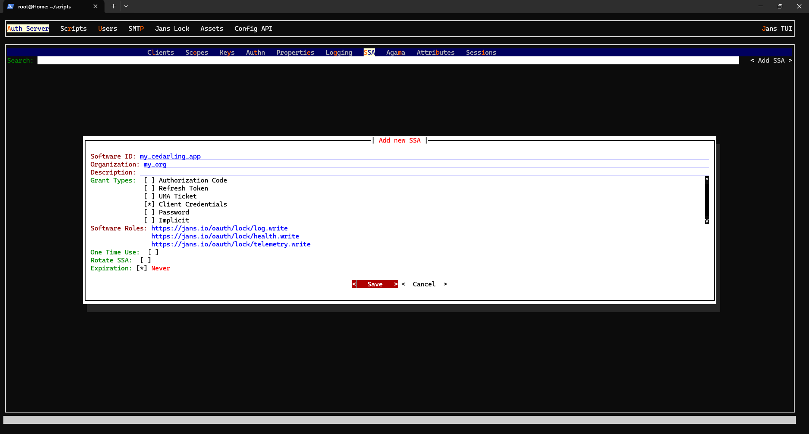

---
tags:
  - cedarling
  - lock server
---

# Cedarling Lock Integration Setup Guide

For a Cedarling client to communicate with the Lock Server, it has to perform [Dynamic Client Registration **(DCR)**](https://datatracker.ietf.org/doc/html/rfc7591) with the Jans Auth Server.

By default, clients cannot obtain the necessary scopes to interact with the lock server. Additional configuration is required on both the Auth Server and the client.

> **Alternative (native targets only, primarily for testing):** If you already have a pre-issued access token (e.g., provisioned externally or minted for a test setup), you can skip the DCR flow entirely by setting [`CEDARLING_LOCK_ACCESS_TOKEN_JWT`](./cedarling-properties.md#lock-server-integration-properties). This is mainly intended to simplify the bootstrap flow during testing and local development; in that case, the Auth Server setup below is not required. This property is **not available on WASM builds** — WASM targets must use the SSA → DCR flow.

This guide will walk you through the following setup processes:

- [Auth Server Setup](#auth-server-setup)
- [Client Setup](#client-setup)

---

## Auth Server Setup

### 1. Creating an SSA JWT

First, create a Software Statement Assertion (SSA) for your Cedarling client.

The easiest way to do this is to use the Jans TUI:

```sh
jans tui
```

Navigate to:
    `Auth Server` > `SSA` > `Add SSA`



When creating the SSA, ensure you:

- Add the `Client Credentials` grant type
- Include the following software roles:
    - `https://jans.io/oauth/lock/log.write`
    - `https://jans.io/oauth/lock/health.write`
    - `https://jans.io/oauth/lock/telemetry.write`
    - `https://jans.io/oauth/lock/policy.readonly` (to load policy stores from Lock Server)

After creation, **export the SSA token** and save it securely.

### 2. Setting up the Interception Script

Next, configure an [*interception script*](../../janssen-server/developer/scripts/README.md) to automatically add the required scopes when a Cedarling client registers.

In your server, create a script file at `/opt/jans/jetty/jans-auth/custom/script/add_cedarling_scopes.py` with the following content:

```py
--8<-- "jans-cedarling/lock-server-script/add_cedarling_scopes.py"
```

* *you can also find a copy of this script in [jans/jans-cedarling/lock-server-script/add_cedarling_scopes.py](https://github.com/JanssenProject/jans/blob/main/jans-cedarling/lock-server-script/add_cedarling_scopes.py)*.

Next, create a JSON file named `script_schema.json` with the following content:

```json
--8<-- "jans-cedarling/lock-server-script/script_schema.json"
```

* *you can also find a copy of this schema in [jans/jans-cedarling/lock-server-script/script_schema.json](https://github.com/JanssenProject/jans/blob/main/jans-cedarling/lock-server-script/script_schema.json)*.

The script adds the scopes only to clients that register with an SSA. A JWT that is not an SSA, such as an `id_token`, gets no scopes, and neither does an SSA from this Auth Server that it does not know or that is in the `REVOKED` or `EXPIRED` state. Set `ssa_issuer` to the `iss` of your SSAs to accept SSAs from that issuer only; leave it empty to accept any issuer whose signature verifies against `jwks_uri`.

> Note:
>
> Do not change the field ordering; The Jans server expects a specific structure.

Finally, register the script with the Auth Server:

```sh
jans cli --operation-id post-config-scripts --data ./script_schema.json
```

### 3. Testing the Setup

You can verify the setup by initializing a client registration with your SSA:

```sh
curl -kX POST https://demoexample.jans.io/jans-auth/restv1/register \
  -H "Content-Type: application/json" \
  -d '{
    "token_endpoint_auth_method": "client_secret_basic",
    "grant_types": ["client_credentials"],
    "client_name": "cedarling-test",
    "access_token_as_jwt": true,
    "scope": "cedarling",
    "software_statement": "<YOUR_SSA_HERE>"
}'
```

A successful response will contain the following scopes:

```json
{
  "scope": "https://jans.io/oauth/lock/log.write https://jans.io/oauth/lock/health.write https://jans.io/oauth/lock/telemetry.write https://jans.io/oauth/lock/policy.readonly"
}
```

> Note:
>
> If you want to learn more about configuring the example interception script, see the [reference](../../janssen-server/developer/scripts/README.md).

---

## Client Setup

To enable Lock Server integration in the Cedarling client, configure the appropriate [bootstrap properties](./cedarling-properties.md).

Here's a table of the available properties:

| Property | Description | Allowed Values | Default |
| --- | --- | --- | --- |
| `CEDARLING_LOCK` | Toggles the all the Lock Server integration features. | `enabled`, `disabled` | `disabled` |
| `CEDARLING_LOCK_SERVER_CONFIGURATION_URI` | URI to fetch Lock Server metadata (`.well-known/lock-server-configuration`). Required if `CEDARLING_LOCK` is `enabled`. | String | `""` |
| `CEDARLING_LOCK_DYNAMIC_CONFIGURATION` (WIP) | Toggles listening for Server-Sent Events (SSE) config updates. | `enabled`, `disabled` | `disabled` |
| `CEDARLING_LOCK_SSA_JWT` | SSA JWT used for DCR. This is required if you followed the [auth server setup](#auth-server-setup). | String | `""` |
| `CEDARLING_LOCK_ACCESS_TOKEN_JWT` | Pre-issued access token for Lock Server authentication. When set, **bypasses the SSA → DCR → access token flow entirely**. **Primarily intended for testing / local development** to simplify the bootstrap flow; may also be used when token issuance is managed externally or DCR is unavailable. If both this and `CEDARLING_LOCK_SSA_JWT` are set, this property takes precedence. **Not available on WASM builds.** | String | `""` |
| `CEDARLING_LOCK_LOG_INTERVAL` | Frequency (in seconds) of sending log messages to the Lock Server. `0` disables transmission. | uint | `0` |
| `CEDARLING_LOCK_HEALTH_INTERVAL` (WIP) | Frequency (in seconds) of sending health messages to the Lock Server. `0` disables transmission. | uint | `0` |
| `CEDARLING_LOCK_TELEMETRY_INTERVAL` (WIP) | Frequency (in seconds) of sending telemetry messages to the Lock Server. `0` disables transmission. | uint | `0` |
| `CEDARLING_LOCK_LISTEN_SSE` (WIP) | Toggles listening for updates from the Lock Server via SSE. | `enabled`, `disabled` | `disabled` |
| `CEDARLING_LOCK_ACCEPT_INVALID_CERTS` | Allows connection to servers with invalid certificates (for testing purposes only; not available for WASM builds).| `enabled`, `disabled` | `disabled` |
| `CEDARLING_LOCK_TRANSPORT` | The transport type to use for communication with the Lock Server. The gRPC transport requires compiling Cedarling with the `grpc` feature enabled. | `rest`, `grpc` | `rest` |
| `CEDARLING_LOCK_LOG_CHANNEL_CAPACITY` | Channel capacity for buffering log entries before sending to the Lock Server. Higher values allow more buffering when the server is slow, but increase memory usage. | uint | `100` |
| `CEDARLING_LOCK_LOG_MAX_RETRIES` | Maximum number of retry attempts for sending logs to the Lock Server. Uses exponential backoff. | uint | `5` |

## Loading Policy Stores from Lock Server

Lock Server can serve `.cjar` policy stores registered as policy sources, for example through the Config API `POST /jans-config-api/lock/policy-stores`. Lock serves each store at `/jans-lock/api/v1/policy/{policy_store_id}`.

Point Cedarling at that URL with `CEDARLING_POLICY_STORE_URI` and enable Lock integration. When the URL has the same origin (scheme, host and port) as `CEDARLING_LOCK_SERVER_CONFIGURATION_URI`, Cedarling sends its Lock access token with policy store requests, including periodic refresh. The URL must use `https` (plain `http` is accepted only for `localhost` and loopback addresses). The token needs the `https://jans.io/oauth/lock/policy.readonly` scope. Requests to other hosts never carry the token.
