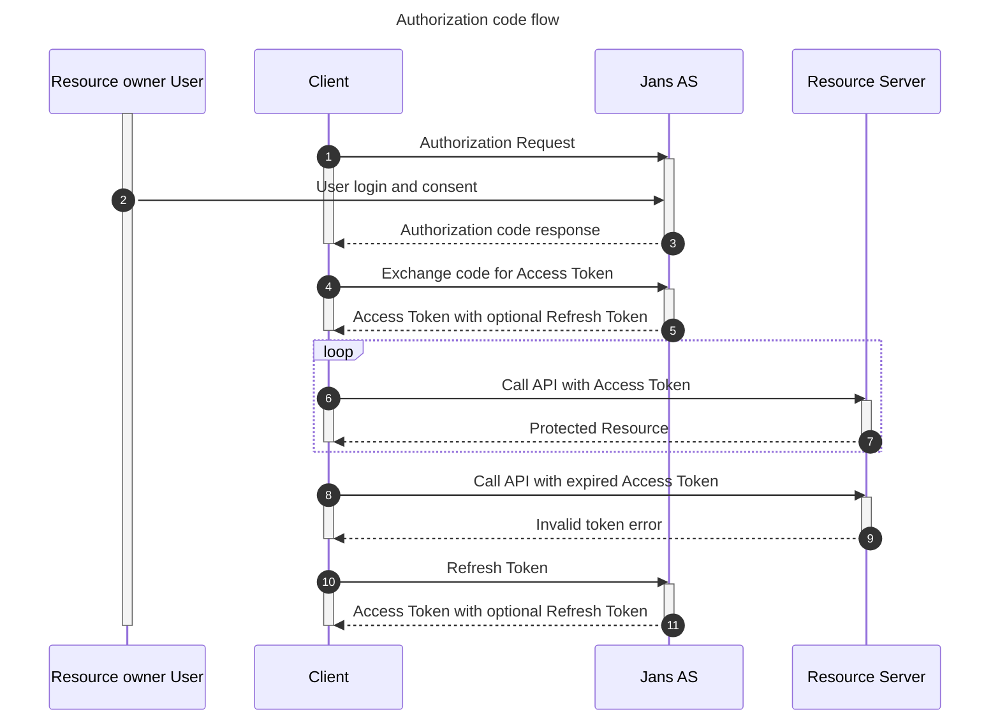

---
tags:
  - administration
  - auth-server
  - oauth
  - feature
  - grant
  - code
---

# Authorization Code Grant

The [Authorization Code Grant](https://datatracker.ietf.org/doc/html/rfc6749#section-4.1) enables public and confidential clients to obtain access tokens through an authorization code issued by the Janssen Authentication Server.

The client initiates an authorization request and redirects the user to Janssen for authentication and, when required, consent. After successful authorization, Janssen redirects the user back to the client's registered redirect URI with an authorization code. The client then exchanges this code at the token endpoint to obtain an access token and, when applicable, additional tokens.

Janssen requires Proof Key for Code Exchange (PKCE) by default for the Authorization Code Grant, using the `S256` code challenge method. PKCE binds the authorization request to the token request and helps protect against authorization code interception. Legacy configurations may allow PKCE enforcement to be disabled, but PKCE should remain enabled for OAuth 2.1-aligned applications.

### Sequence Diagram

### Testing

1. Refer to the [Authorization Code Flow integration test](https://github.com/JanssenProject/jans/blob/main/jans-auth-server/client/src/test/java/io/jans/as/client/ws/rs/AuthorizationCodeFlowHttpTest.java)

2. On a browser access 
`https://my.jans.server/jans-auth/restv1/authorize?redirect_uri=https%3A%2F%2Fmy-redirect-app%3A8080&client_id=Put_client_id_here&scope=openid%20profile&response_type=code&code_challenge=GENERATED_CODE_CHALLENGE&code_challenge_method=S256&state=RANDOM_STATE_VALUE` 
    
    Based on the configured authentication method (`acr`), the Janssen Authentication Server prompts the user to authenticate and obtains consent when required.

3. After successful authentication, the following steps take place:
    - Janssen redirects the user back to the application's registered redirect URI with an authorization code.
    - The application sends the authorization code and the original PKCE `code_verifier` to the Janssen token endpoint.
    - Janssen validates the authorization code and PKCE verifier, then issues an access token and, for an OpenID Connect request containing the `openid` scope, an ID token. A refresh token may also be issued when applicable.
    - The application validates the ID token to obtain authentication information about the user and uses the access token to access protected resources or retrieve user claims from the UserInfo endpoint.