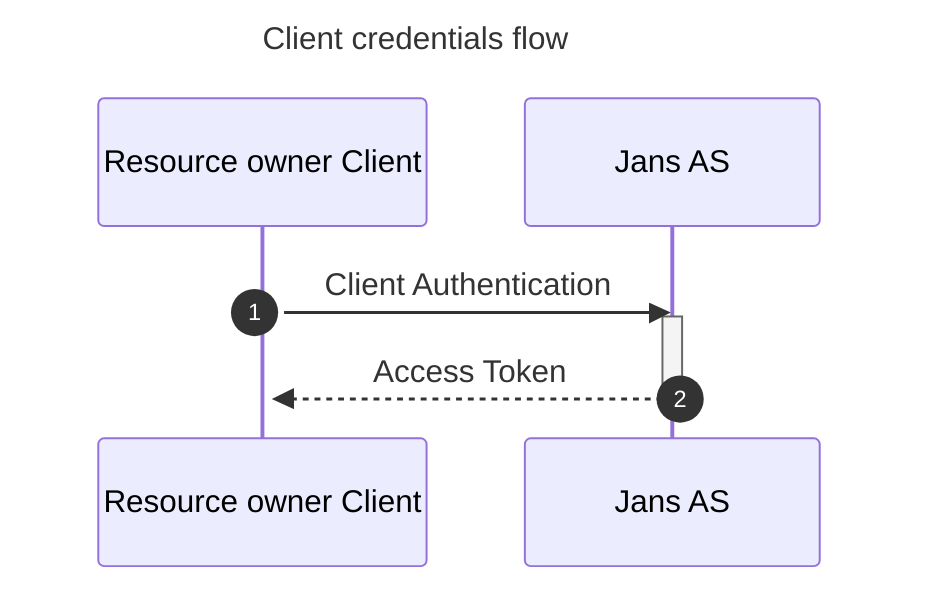

---
tags:
  - administration
  - auth-server
  - oauth
  - feature
  - grant
  - client-credentials
---

# Client credentials Grant

The [Client Credentials Grant](https://datatracker.ietf.org/doc/html/rfc6749#section-4.4) allows a confidential client to obtain an access token from the Janssen Authentication Server using its own credentials, without involving an end-user.

This grant is commonly used for machine-to-machine (M2M) communication, where an application or service needs to access protected resources on its own behalf. The client authenticates directly with the Janssen token endpoint and receives an access token based on its authorized scopes.

### Sequence Diagram


### Testing

1. Refer to the [Client Credentials Grant integration test](https://github.com/JanssenProject/jans/blob/main/jans-auth-server/client/src/test/java/io/jans/as/client/ws/rs/ClientCredentialsGrantHttpTest.java)

2. Send a token request to the Janssen Authentication Server using the Client Credentials Grant:

```bash
   curl -X POST "https://my.jans.server/jans-auth/restv1/token" \
     -u "YOUR_CLIENT_ID:YOUR_CLIENT_SECRET" \
     -d "grant_type=client_credentials" \
     -d "scope=YOUR_SCOPE"
```
