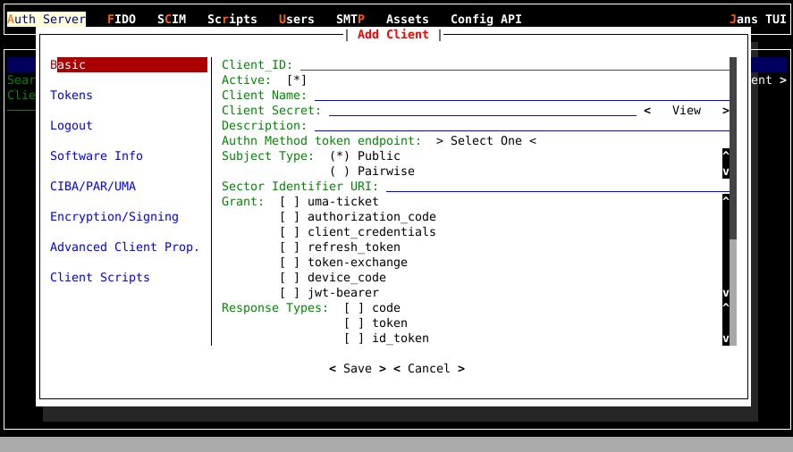

---
tags:
  - administration
  - auth-server
  - oauth
  - feature
  - grant
  - password
---

# Password Grant

!!! warning "Legacy grant"
    The Resource Owner Password Credentials (ROPC) Grant is not included in
    OAuth 2.1 and is not enabled in Janssen's default supported grant types.
    It is not recommended for new integrations. Legacy deployments may
    explicitly configure support for this grant. For new applications,
    use the Authorization Code Grant with PKCE (`S256`) instead.
    Verify the grant types advertised in the deployment's discovery metadata.

Janssen Server can support the password grant when explicitly enabled. At the same time, in line with
[OAuth 2.0 security best practices](https://oauth.net/2/oauth-best-practice/), this password grant should never be used
in practice. [OAuth 2.1](https://datatracker.ietf.org/doc/html/draft-ietf-oauth-v2-1-08) has removed this grant type.

## Configuration

A client can use the password grant only when it is enabled both for the authorization server and
for that client. Add `password` to the authorization server's
[grantTypesSupported](../../reference/json/properties/janssenauthserver-properties.md#granttypessupported)
property (in TUI, navigate to **Auth Server -> Properties -> grantTypesSupported**), and add
`password` to the client's grant types using
[TUI](../../config-guide/config-tools/jans-tui/README.md). Otherwise, the token endpoint rejects
the request. See the [token endpoint documentation](../endpoints/token.md#token-endpoint) for details.

## Usage

Using the password grant involves sharing user credentials with a third-party application. This third-party app which has
registered with Janssen Server as a client, will then use user-id/password credentials from the user to obtain an
access token from Janssen Server.

Janssen Server also requires the client to authenticate itself based on the client configuration.

Since sharing user credentials with a third-party app is a security risk and against the basic purpose of OAuth, this
grant type shall not be used.

## Want to contribute?

If you have content you'd like to contribute to this page, you can get started with our [Contribution guide](https://docs.jans.io/head/CONTRIBUTING/).
