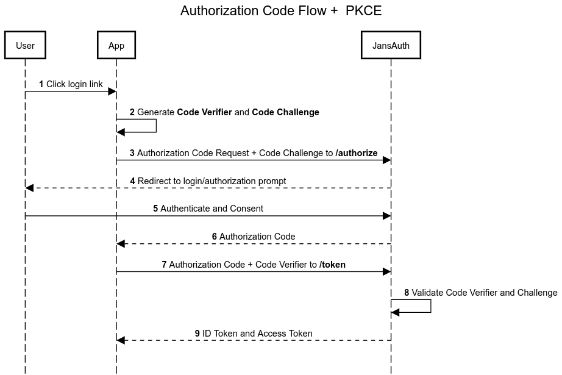
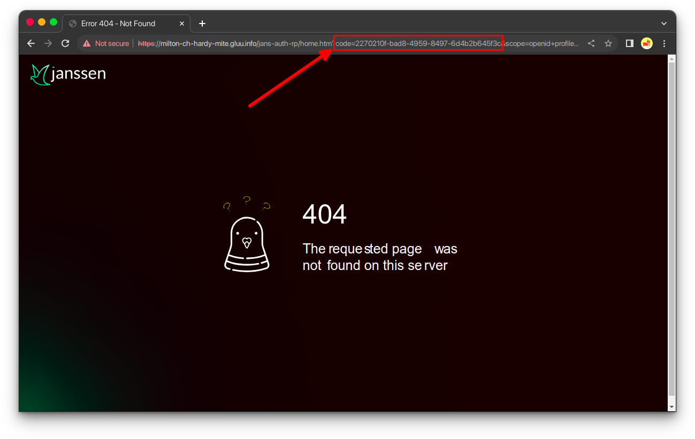

---
tags:
  - administration
  - auth-server
  - oauth
  - feature
  - pkce
---

# PKCE (Proof Key for Code Exchange)

Proof Key for Code Exchange (PKCE), defined in
[RFC 7636](https://datatracker.ietf.org/doc/html/rfc7636), is a security
extension to the OAuth Authorization Code Grant. It helps protect against
authorization code interception and injection attacks by binding the
authorization request to the token request.

Public clients, such as Single Page Applications (SPAs) and mobile applications,
cannot securely store client secrets. PKCE protects the authorization code
exchange without requiring a client secret.

Janssen requires PKCE by default for the Authorization Code Grant, including
public and confidential clients, using the `S256` code challenge method.

Let's see in the following diagram how it works:



[Source](https://sequencediagram.org/index.html#initialData=C4S2BsFMAIEEFdgAsD2AnEAvAhqFA7aAYRQBMYAxcFAd2gGppoAFAaSIFEAoLgB2zSgAxiH75g0AKoBnSGj4Dho7OLi9eCwSBFiJAKRXSEyHtkQF4AWwBGcnjLkBaAHyx1ALmLhtAa2jUAcxBCb3wfLjdeF0jPAHFIfDlcGAAqFJJyaAA1ORAAMxA5NOgVUmg0jJgiJGxwKHwAyDSI9RcDfCNEJE9jVAwcPEJK6AAlSABHeEhpCUZh6tr6xuhgFHKUgHozZHQsJpSuds7kRxcHNE8x0hA0SCEJVf8UIPwtrt2BkAJoXjQUS14wC45zahl6PS6CWEyRK+DKJA6UMOYK6p1cHjg736uC+QzIkBaUWcR3BmJ22MGxHxDCpmRyGAKchWazSG1WPgSzRJqOJKOQniytRApBhw3p+UKaFh8JqdQSjWRHV6aJi0AAkgARaAAFRQHMIpTgQiE02kOr1CS4QA)

## PKCE Configuration

Janssen requires PKCE for the Authorization Code Grant by default through the
server-level `requirePkce` property. A client can also require PKCE through its
client attributes. Setting the server-level property to `false` does not disable
PKCE for clients that individually require it.

Only the `S256` code challenge method is accepted. Requests using `plain`,
an unsupported method, or a `code_challenge` without an explicit
`code_challenge_method=S256` are rejected. See the
[authorization-server configuration](../../config-guide/auth-server-config/jans-authorization-server-config.md)
and the [`requirePkce` property reference](../../reference/json/properties/janssenauthserver-properties.md#requirepkce).

## Authorization Code Flow + PKCE

In this flow, we will execute the following steps:

1. Generate **Code Verifier** and **Code Challenge**
2. Register new client
3. Call `authorize` endpoint
4. Call `token` endpoint

### 1. Generate Code Verifier and Code Challenge

It is necessary to generate these codes for this flow, since this data will be
sent in the `authorize` and `token` endpoints.

#### Code Verifier

It is a random string of length `N`, and is denoted by the field `code_verifier`.

The following command generates a `code_verifier` of length `128`.

```bash
tr -dc 'A-Za-z0-9-._' </dev/urandom | head -c 128; echo
```

Output example:

```bash
root@jans:~# tr -dc 'A-Za-z0-9-._' </dev/urandom | head -c 128; echo
MW54l5Ma7i8n6QsetI_dnJhfMQ6gIfBNJiWFINu6rtD0zvZUXG3STWoolT5HFatjWu2Vj1L-Au4PtRzkear088FJLzq.6tAg10wikJrIqn75HCJ7V1b_p8io_ugkPkkr
```

#### Code Challenge

To generate the `code_challenge` we need to know what type of method we will be using, so this field is accompanied by
the `code_challenge_method` field.

Janssen Server requires `code_challenge_method=S256`. The `code_challenge` is
the base64url-encoded SHA-256 digest of the `code_verifier`.

The following command generates the `code_challenge` using `S256`.

!!! Note
    To execute the command below, you need to have `openssl`, `basenc`
and `tr` installed.

```bash
echo -n "MW54l5Ma7i8n6QsetI_dnJhfMQ6gIfBNJiWFINu6rtD0zvZUXG3STWoolT5HFatjWu2Vj1L-Au4PtRzkear088FJLzq.6tAg10wikJrIqn75HCJ7V1b_p8io_ugkPkkr" | openssl dgst -binary -sha256 | basenc --base64url | tr -d '='
```

Output example:

```bash
root@jans:~# echo -n "MW54l5Ma7i8n6QsetI_dnJhfMQ6gIfBNJiWFINu6rtD0zvZUXG3STWoolT5HFatjWu2Vj1L-Au4PtRzkear088FJLzq.6tAg10wikJrIqn75HCJ7V1b_p8io_ugkPkkr" | openssl dgst -binary -sha256 | basenc --base64url | tr -d '='
zyI60XbvMetJJuAzyRR_jnxoJkyfxXSqY-mTG4FtBtg
```

### 2. Register new client

``` text title="Request"
POST <YOUR_DOMAIN>/jans-auth/restv1/register HTTP/1.1
Content-Type: application/json

{
  "client_name": "PKCE Test Client",
  "application_type": "web",
  "token_endpoint_auth_method": "none",
  "scope": [
    "openid",
    "profile",
    "email"
  ],
  "grant_types": [
    "authorization_code"
  ],
  "response_types": [
    "code"
  ],
  "redirect_uris": [
    "https://<YOUR_DOMAIN>/jans-auth-rp/home.htm"
  ]
}
```

!!! Note
    Note that the `token_endpoint_auth_method` field is `none`.

```text title="Response"
HTTP/1.1 201 Created
Date: Fri, 17 Nov 2023 22:51:13 GMT
Server: Apache/2.4.41 (Ubuntu)
X-Xss-Protection: 1; mode=block
X-Content-Type-Options: nosniff
Strict-Transport-Security: max-age=31536000; includeSubDomains
Expires: Thu, 01 Jan 1970 00:00:00 GMT
Cache-Control: no-store
Content-Type: application/json
Pragma: no-cache
Content-Length: 1541
Set-Cookie: X-Correlation-Id=d92eddf5-ab08-4b4f-a8f1-10af67e83dbd; Secure; HttpOnly;HttpOnly
Connection: close

{
  "allow_spontaneous_scopes": false,
  "application_type": "web",
  "rpt_as_jwt": false,
  "registration_client_uri": "https://<YOUR_DOMAIN>/jans-auth/restv1/register?client_id=f48fbdfa-4c07-49e5-938b-10463980e145",
  "tls_client_auth_subject_dn": "",
  "run_introspection_script_before_jwt_creation": false,
  "registration_access_token": "659ccbf9-ac98-437a-b952-33bfc0366fc2",
  "client_id": "f48fbdfa-4c07-49e5-938b-10463980e145",
  "token_endpoint_auth_method": "none",
  "scope": "email openid profile",
  "client_secret": "a656a654-c930-4b52-9edb-68ead50d046e",
  "client_id_issued_at": 1700261473,
  "backchannel_logout_uri": "",
  "backchannel_logout_session_required": false,
  "client_name": "PKCE Test Client",
  "par_lifetime": 600,
  "spontaneous_scopes": [],
  "id_token_signed_response_alg": "RS256",
  "access_token_as_jwt": false,
  "grant_types": [
    "authorization_code"
  ],
  "subject_type": "pairwise",
  "additional_token_endpoint_auth_methods": [],
  "keep_client_authorization_after_expiration": false,
  "require_par": false,
  "redirect_uris": [
    "https://<YOUR_DOMAIN>/jans-auth-rp/home.htm"
  ],
  "redirect_uris_regex": "",
  "additional_audience": [],
  "frontchannel_logout_session_required": false,
  "client_secret_expires_at": 1700347873,
  "access_token_signing_alg": "RS256",
  "response_types": [
    "code"
  ]
}
```

### 3. Call `authorize` endpoint

From your browser of choice call the following url:

``` text title="Request"
https://<YOUR_DOMAIN>/jans-auth/restv1/authorize?
response_type=code&
client_id=f48fbdfa-4c07-49e5-938b-10463980e145&
scope=openid+profile+email&
redirect_uri=https://<YOUR_DOMAIN>/jans-auth-rp/home.htm&
state=bf1af4a1-8713-49c6-b229-537bf4cf712d&
nonce=f2265e46-6d93-4d36-850b-8fd990cccd04&
code_challenge=<YOUR_CODE_CHALLENGE>&
code_challenge_method=S256
```

!!! Note
    Remember that this **endpoint** is where you must send the `code_challenge` and `code_challenge_method`
parameters.

The field we need to obtain is the `code`.



### 4. Call `token` endpoint

Previously we have obtained the `code` field, we will use this value to call the endpoint `token`.

```text title="Request"
POST <YOUR_DOMAIN>/jans-auth/restv1/token HTTP/1.1
Content-Type: application/x-www-form-urlencoded

grant_type=authorization_code&
redirect_uri=https://<YOUR_DOMAIN>/jans-auth-rp/home.htm&
client_id=f48fbdfa-4c07-49e5-938b-10463980e145&
code_verifier=<YOUR_CODE_VERIFIER>&
code=<YOUR_CODE>
```

```json title="Response"
{
  "access_token": "<ACCESS_TOKEN>",
  "refresh_token": "<REFRESH_TOKEN>",
  "id_token": "<ID_TOKEN>",
  "token_type": "Bearer",
  "expires_in": 299
}
```
