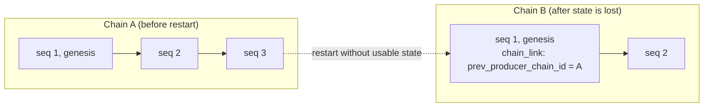

---
tags:
  - administration
  - fido2
  - passkeys
  - audit
  - trace
---

# TRACE Producer

The planned TRACE producer makes jans-fido2 emit one record for each passkey registration and assertion outcome
that has a session, to the Lock Server. Each record is signed and hash-chained. The chain lets a reader detect a
gap or an altered record between records it has seen. It cannot by itself show that the newest records are
missing: detecting tail loss needs an independently trusted checkpoint or an expected chain head. This page
covers the planned configuration properties and what a record contains.

!!! note "Status"
    This is planned behavior, not yet available. The properties are added in
    [#15680](https://github.com/JanssenProject/jans/pull/15680) and take effect only after that PR and the
    follow-up work tracked in [#15275](https://github.com/JanssenProject/jans/issues/15275) (record emission,
    signing, and transport) are merged. Until then, setting `fido2TraceEnabled` to `true` does not change behavior.

    **Lock dependency:** the producer's key must be registered on Lock with `FIDO_CEREMONY` in its
    `authorized_event_kinds`. The current Lock Server does not define that event kind, so delivery will fail
    until Lock adds support for it.

## Configuration

All properties are set in the `fido2Configuration` object, the same place as the Lock audit properties in
[FIDO2 Configuration Parameters](fido2-server-properties-config.md#fido2-configuration-object-fido2configuration).

| Property | Type | Default | Description |
|---|---|---|---|
| `fido2TraceEnabled` | Boolean | `false` | Planned. Master switch. When `false`, nothing is emitted. |
| `fido2TraceProducerId` | String | derived | Planned. Stable producer ID. Leave empty to derive it from the server ID and version; the derived value can change on upgrade, so set an explicit ID for continuity. |
| `fido2TraceChainGenesis` | String | `first_observed` | Planned. `pre_registered` if Lock knows each node's chain genesis in advance, otherwise `first_observed`. |
| `fido2TraceIncludeCredentialIdHash` | Boolean | `true` | Planned. Include `credential_id_hash`, a hash of the credential ID, rather than the raw credential ID. |
| `fido2TraceIncludeAttestationDetail` | Boolean | `false` | Planned. Include optional signed attestation and MDS trust detail in each record. |
| `fido2TraceEndpoint` | String | discovered | Planned. Lock Server ingestion endpoint, `/jans-lock/api/v1/audit/trace`. |
| `fido2TraceKeyStorePath` | String | — | Planned. Path to a BCFKS keystore file that holds the Ed25519 producer signing key. The key stays in the file and is never stored in configuration. |
| `fido2TraceKeyAlias` | String | — | Planned. Alias of the Ed25519 signing key inside `fido2TraceKeyStorePath`. |
| `fido2TraceKeyStorePassword` | String | — | Planned. Keystore password, encrypted at rest like other client secrets. |

The TRACE properties are separate from the `lockAudit*` properties. Enabling one does not enable the other.

The client that sends records uses the `trace.write` scope, requested when the FIDO Server registers as a client
through the SSA-to-DCR client-credentials flow.

## What a record contains

Each record is a `FIDO_CEREMONY` event.

- **Event kind:** `trace.event_kind` is `FIDO_CEREMONY`.
- **Ceremony:** `ceremony_type` is `REGISTRATION` or `ASSERTION`.
- **Outcome:** `ceremony_outcome` is `SUCCESS`, `FAILURE`, or `ABANDONED`.
- **Authenticator:** `authenticator_attachment` is `platform` or `cross-platform`.
- **Correlation:** `trace.session_id` is required. Ceremonies with no session do not emit a record by default.
- **Integrity:** `record_id`, `sequence_number`, `prev_record_hash`, and an Ed25519 `signature` over the
  RFC 8785 (JCS) canonical form of the record.

Records do not contain policy decisions, invocations, or capability IDs. TRACE records describe what happened
in a ceremony, and they do not affect how the ceremony is decided.

## Chains

Each FIDO Server node keeps its own chain. A chain is a sequence of signed records that share one
`producer_chain_id`. Each record carries:

- `producer_chain.producer_chain_id`: the chain the record belongs to.
- `producer_chain.sequence_number`: the position in the chain. The first record is `1`, and each record after it is
  one higher.
- `producer_chain.prev_record_hash`: the hash of the previous record in the same chain. The first record has the
  all-zero sentinel, `sha256:` followed by 64 zeros.
- `producer_chain.chain_link` (genesis only): an object with `prev_producer_chain_id`, which names the chain this one
  follows after a restart. Only the first record of a chain can carry it.

### Hash input

`prev_record_hash` is `sha256:` followed by the lowercase hex SHA-256 of the RFC 8785 (JCS) canonical form of the
previous record, including its `signature`. Hash the signed record, not the unsigned one. This is the same digest
Lock calls `content_digest`, so a producer and Lock compute the same value for each record.

### Restart

On startup a node resumes its existing chain when the saved state is usable: it belongs to this node and holds a
chain id, a next sequence number of at least 1, and a well-formed previous hash. The node then continues with the
next sequence number and the saved previous hash.

When the state is missing, corrupt, malformed, or belongs to another node, the node starts a new chain:

- It gets a new `producer_chain_id`, and its first record has `sequence_number` 1 and the zero sentinel.
- If the previous chain id for this node is still known, the genesis record carries `chain_link` pointing to it.
  If it is not known, for example after the state file is corrupted, the new genesis has no `chain_link`.



Lock checks only the shape of `chain_link`, and only on a genesis record. It does not check the link against chain A.
The link is therefore a claim in the signed record, not something Lock has verified.

### Clusters

Each node has its own chain, so N nodes produce N independent chains. Lock verifies each chain on its own: gaps,
broken `prev_record_hash` links, and conflicting records at the same position (equivocation) are reported per chain.

Each node needs its own state file. Do not copy one node's state file to another node. The copy names a different
node, so the receiving node rejects it and starts a new chain. Two running nodes that write to the same state file
would produce records with the same sequence numbers, which Lock reports as equivocation.

### Where state lives and what a crash loses

The producer keeps its chain state in a small file, written atomically: it writes a temporary file, flushes it to
disk, and renames it over the old one. It writes the next state before it returns a signed record, so:

- A crash before the state is written loses nothing that was sent. The next start reissues the same sequence number.
- A crash after the state is written but before the record is sent leaves a gap in the sequence. Lock reports the gap
  with `coverage_gap_flag`, and the chain continues after it.
- A lost or corrupt state file starts a new chain. Records already sent on the old chain remain valid.

The state file path is part of the emission work tracked in [#15280](https://github.com/JanssenProject/jans/issues/15280).
Until that work is merged, the chain state class does not run in the server.

### Interaction with chain genesis

- With `fido2TraceChainGenesis` set to `first_observed`, a new chain starts with a genesis record that Lock accepts
  and registers. This is the normal case after a restart without usable state.
- With `pre_registered`, Lock must know the new chain before its first record is accepted. A restart that opens a new
  chain therefore needs that chain registered first. The procedure is covered in the pre-registered genesis runbook,
  which is tracked separately.

See [Chain registration modes](../lock/trace.md#chain-registration-modes) for how Lock treats genesis records.

## Signing

A record is signed as follows:

1. Remove the `signature` member, if present, and take the rest of the record.
2. Serialize it with the JSON Canonicalization Scheme (RFC 8785): members sorted by UTF-16 code units, no
   insignificant whitespace, and numbers in the ECMAScript form, for example `1e+30` and `0.000001`.
3. Sign the UTF-8 bytes of that canonical form with Ed25519 (RFC 8032).
4. Store the 64-byte signature as base64url without padding, which is 86 characters.

Records that contain an unpaired surrogate, or a non-finite number such as NaN, are rejected rather than signed.
Hashes use the `sha256:` prefix followed by the lowercase hex digest.

The `prev_record_hash` of a record is the `content_digest` of the previous record. Lock computes that digest over
the complete previous record, including its `signature`. Hash the signed form, not the unsigned form, when you
set `prev_record_hash`. Otherwise Lock flags the link with `chain_link_failure_flag`.

## Signing key

The producer key is an Ed25519 key in a BCFKS keystore. Create one with a BouncyCastle provider jar. `keytool`
prompts for the keystore and key passwords, so do not pass them on the command line:

```bash
keytool -genkeypair -storetype BCFKS -keystore /etc/jans/conf/trace-producer.bcfks \
  -alias trace-producer -keyalg Ed25519 -dname "CN=jans-fido2-trace" -validity 3650 \
  -providerpath /path/to/bcprov-jdk18on.jar \
  -providerclass org.bouncycastle.jce.provider.BouncyCastleProvider
```

Then set `fido2TraceKeyStorePath` to the file, `fido2TraceKeyAlias` to `trace-producer`, and
`fido2TraceKeyStorePassword` to the keystore password. The password is encrypted when it is stored.

### Register the public key on Lock

Lock needs the public key as an Ed25519 JWK. Export the certificate that `keytool` created, then take the raw
32-byte key from its public key and encode it as base64url:

```bash
keytool -exportcert -storetype BCFKS -keystore /etc/jans/conf/trace-producer.bcfks -alias trace-producer \
  -providerpath /path/to/bcprov-jdk18on.jar \
  -providerclass org.bouncycastle.jce.provider.BouncyCastleProvider -file trace-producer.der
openssl x509 -inform DER -in trace-producer.der -pubkey -noout > trace-producer.pem
openssl pkey -pubin -in trace-producer.pem -outform DER | tail -c 32 | base64 | tr '+/' '-_' | tr -d '='
```

Register the result with `{"kty": "OKP", "crv": "Ed25519", "x": "<output>"}` as described in
[Register a key](../lock/trace.md#register-a-key). Lock does not yet define the `FIDO_CEREMONY` event kind, so
registration with that kind cannot succeed until Lock adds it.

### Rotating the signing key

Lock accepts a new key only under a new `kid`, and it never changes a registered key. To rotate:

1. Create a new key with a new alias, or in a new keystore file.
2. Register its public key on Lock under a new `kid`, as described in [Register a key](../lock/trace.md#register-a-key).
3. Set `fido2TraceKeyAlias` or `fido2TraceKeyStorePath` to the new key.
4. Revoke the old key on Lock once its records no longer need to be verified, as described in
   [Revoke a key](../lock/trace.md#revoke-a-key).
5. Decide whether the producer chain continues or starts a new one. See
   [Register a producer chain](../lock/trace.md#register-a-producer-chain) for when a new chain is needed.

!!! warning "FIPS builds"
    Ed25519 signs and verifies under the BC-FIPS 1.0.2.7 provider that the FIPS build uses. When BC-FIPS
    approved-only mode is enabled, Ed25519 is rejected. Jans does not enable that mode, so TRACE signing works
    in the FIPS build but is not FIPS-approved. Do not describe TRACE signing as FIPS-approved until this changes.

!!! note "Lock compatibility"
    For integers above 2^53, RFC 8785 requires rounding to an IEEE double before serialization. The current Lock
    canonicalizer does not do this, so records with such integers fail verification on Lock. Tracked in
    [#15703](https://github.com/JanssenProject/jans/issues/15703).

## Delivery

Records are sent asynchronously and in batches, never one HTTP call per ceremony, and they are kept off the
ceremony's hot path. Delivery is retried on transport failure.
