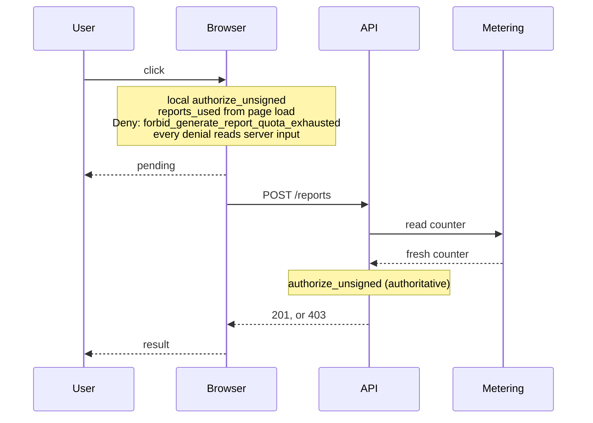

# Pattern: Advisory Denials in a Client-Side PDP

!!! note "Illustrative example"

    Acme Reports, the `@server_input` key, and every `@checks` value below are invented for this
    page. Cedarling attaches no meaning to them; they work only because the example application
    reads them. See [Policy Annotation Patterns](./annotation-patterns.md) for the ground rules.

## The Scenario

Acme's reporting dashboard is a browser application with Cedarling embedded through the WASM
package. It authorizes locally before it calls the API, which is what makes the interface feel
immediate: buttons that would fail are disabled, and a click that cannot succeed is answered without
a round trip.

The API runs Cedarling too, over the same policy store, and re-evaluates every request. That is not
duplicate work: the browser copy exists for the interface, and the server copy protects the data.

Now two different denials arrive at the same button.

The user is a viewer, and viewers do not generate reports. The browser knows the user's role, the
role is not going to change between the click and the request, and the server would say exactly the
same thing. Rendering "you do not have access" locally is correct and costs nothing.

The workspace has used up its monthly quota. The browser is comparing against a counter it
fetched when the page loaded, and the real figure lives in the metering service. That number may
have moved in either direction: the month may have rolled over, an administrator may have raised the
plan, or another tab may have consumed the remainder. A local denial here is a guess.

Both are `Deny`. Only one of them is worth showing.

## The Policy Describes Its Inputs

The browser cannot tell the two denials apart from the decision alone. The policy can help, without
telling the browser what to do, by stating a fact about itself: which of its inputs only the server
holds fresh.

```cedar
@server_input("reports_used")
```

That is a description, not an instruction. It is true whoever evaluates the policy. The browser
draws its own conclusion from it: a denial that rests on server-held input is not one it can
confirm. The server draws none, because for the server the input is fresh.

## Why This Is Safe

A client-side PDP can be wrong in only one direction that matters. It cannot grant anything, because
the server evaluates the same request again and grants nothing on the browser's say-so. What it can
do is refuse something the server would have allowed, which is a correctness problem in the
interface rather than a security problem.

The pattern relies on this one-way risk. Sending the request anyway, after a local denial, gives
away nothing: the authoritative answer is still the server's.

The reverse must never exist. Nothing lets a client skip the request after a local `Allow`, and
nothing lets it disregard a denial from the server. Those would move the decision to the least
trustworthy participant.

This safety is not free. It holds only while the following five conditions hold, and each one has
to be kept that way:

- Every guarded call is authorized again on the server, from inputs the server resolved itself. A
  single endpoint that trusts the browser's decision, or that rebuilds the request from what the
  browser sent, ends the guarantee for that endpoint.
- The client renders denials and never shapes data. Masking and row limits are applied by whoever
  builds the response, which is the server. A browser that masks columns it received in the clear
  only changes how data it already has is displayed.
- Everything the browser evaluates is treated as public. The embedded PDP holds the policy store and
  the entity attributes it reasons over, so thresholds, tier names, contract quotas, and risk tiers
  are readable by anyone who opens the developer tools. Ship only what you are willing to show, and
  keep policies whose contents are themselves sensitive on the server.
- The action's effect is a server call. An action the browser can carry out alone, revealing a field
  already on the page or exporting rows it already downloaded, has no second check behind it, and
  there the local PDP is the only PDP. Do not guard those this way.
- The endpoint is safe to call when the answer is no. Every provisional denial becomes a request
  that the server is expected to refuse, so refusals must not start metered work, increment
  counters, or leave half an effect behind, and the endpoint needs capacity for traffic the client
  used to absorb.

## Which Policies Carry It

The ones whose conditions rest on facts the browser cannot hold fresh, which in practice means facts
the server owns:

- counters and quotas, like `context.reports_used`
- approval records, like `context.approvals`
- collected evidence, like `context.attestations`
- validated incident or session state, like `context.incident_id`
- risk attributes a backend investigation updates, like `principal.risk_tier`

Those examples are the inputs from the other pages in this section, which is not a coincidence.
Every one of them describes something the server established and the client carries a copy of.

A denial that rests on the principal's role, the resource's type, or anything else the browser
received with its tokens is in the opposite position. It is as good locally as it is remotely, and
its policy carries no `@server_input`.

## Schema

```cedarschema
namespace Acme {
    entity User = {
        "role": String,
    };

    entity Workspace;

    action "GenerateReport" appliesTo {
        principal: [User],
        resource: [Workspace],
        context: {
            "reports_used": Long,
        }
    };

    action "ExportRows" appliesTo {
        principal: [User],
        resource: [Workspace],
        context: {}
    };
}
```

## Policies

The same four policies run in the browser and on the server. Only one of them reads server-held
input.

```cedar
@id("permit_generate_report")
permit (
    principal,
    action == Acme::Action::"GenerateReport",
    resource
);
```

```cedar
@id("permit_export_rows")
permit (
    principal,
    action == Acme::Action::"ExportRows",
    resource
)
when { principal.role == "admin" };
```

```cedar
@id("forbid_generate_report_wrong_role")
@checks("report.role_not_permitted")
@detail("Only analysts and admins generate reports.")
forbid (
    principal,
    action == Acme::Action::"GenerateReport",
    resource
)
unless {
    ["analyst", "admin"].contains(principal.role)
};
```

```cedar
@id("forbid_generate_report_quota_exhausted")
@checks("quota.reports.exhausted")
@detail("The workspace has used every report its plan includes this month.")
@server_input("reports_used")
forbid (
    principal,
    action == Acme::Action::"GenerateReport",
    resource
)
when { context.reports_used >= 1000 };
```

`@server_input` names the field, not just the fact, so that a reviewer can check it against the
condition: removing `reports_used` from the policy should remove the label too, and adding a
server-held field to an unlabeled policy should add one.

## The Flow



The pending state is an accurate report of what the browser knows, which at that point is nothing.

## Browser Code

None of this belongs in a click handler. Whether a local denial may be rendered is the same question
for every guarded action in the application, so the answer lives in two pieces that every action
shares: a function that reads the decision, and a wrapper that runs the call.

The first one is pure. Given a decision, it says what the browser is entitled to do with it:

```javascript
// The only place the UI interprets an authorization decision.
function localOutcome(result) {
  if (result.decision) {
    return { proceed: true };
  }

  const diagnostics = result.response.diagnostics;

  // A policy that errored was dropped from the decision. In a browser the usual
  // cause is an input this side failed to load, and the server evaluates the same
  // policies over inputs it owns, so this denial is not ours to render.
  if (diagnostics.errors.length > 0) {
    report(diagnostics.errors);
    return { proceed: true, pending: true };
  }

  const denials = Object.values(cedarling.annotationsByPolicy(diagnostics.reason));

  // A denial resting only on what the browser itself knows, or nothing matched at all.
  const local = denials.find((a) => !a.server_input);

  if (local || denials.length === 0) {
    return { proceed: false, messageId: messageFor(local?.checks) };
  }

  // Every denial reads input the server owns, so none of them is ours to render.
  return { proceed: true, pending: true };
}
```

`messageFor` is the application's own table from `@checks` values to message identifiers, with a
generic fallback for values it does not know.

Both an `Allow` and a fully provisional `Deny` return `proceed: true`. From the browser's side they
are the same situation: it has nothing worth saying, and the server decides. The only difference is
that one of them warns the interface to expect a wait.

A render-time check calls `authorizeOnly` and stops there. Disabling a button is the interface
acting on a denial before any click, so it may only act on a denial the browser is entitled to make:
`proceed: false` renders as disabled, everything else renders as enabled and resolves when clicked.

### Bind the Action to the Call It Guards

The wrapper still needs a request to authorize and a call to make, and if a caller supplies those
separately they are free to drift. The browser can authorize `Acme::Action::"GenerateReport"` and
then post to an endpoint that exports raw rows, and nothing complains: the local check was real, it
just answered a question nobody asked.

Declare the pair once, in a table the whole application shares:

```javascript
// Built once, from the tokens the session already holds.
const principal = {
  cedar_entity_mapping: { entity_type: "Acme::User", id: user.id },
  role: user.role,
};

// The stale counter this whole pattern is about: a snapshot taken at page load.
const usage = usageSnapshot();

const guardedActions = {
  generateReport: {
    action: 'Acme::Action::"GenerateReport"',
    resource: (workspace) => ({
      cedar_entity_mapping: { entity_type: "Acme::Workspace", id: workspace.id },
    }),
    context: (workspace) => ({ reports_used: usage.cached(workspace.id) }),
    call: (workspace) => api.post("/reports", { workspace: workspace.id }),
  },

  exportRows: {
    action: 'Acme::Action::"ExportRows"',
    resource: (workspace) => ({
      cedar_entity_mapping: { entity_type: "Acme::Workspace", id: workspace.id },
    }),
    context: () => ({}),
    call: (workspace) => api.post("/exports", { workspace: workspace.id }),
  },
};

// `target` is what the action operates on, the workspace here. Named `target`
// rather than `subject`, which in authorization usually means the principal.
async function authorizeOnly(name, target) {
  const { action, resource, context } = guardedActions[name];

  const result = await cedarling.authorizeUnsigned(
    JSON.stringify({
      principal,
      action,
      resource: resource(target),
      context: context(target),
    }),
  );

  return localOutcome(result);
}

async function guarded(name, target) {
  const outcome = await authorizeOnly(name, target);

  if (!outcome.proceed) {
    return { status: "denied", messageId: outcome.messageId };
  }

  if (outcome.pending) {
    ui.showPending();
  }

  const response = await guardedActions[name].call(target);

  return response.ok
    ? { status: "ok", body: response.body }
    : { status: "denied", messageId: response.messageId };  // the server's message
}
```

A handler is then one line, names one thing, and knows nothing about annotations or policy IDs:

```javascript
const outcome = await guarded("generateReport", workspace);
```

Two warnings keep this from becoming worse than what it replaces.

The mapping is a declaration, not a naming convention. Cedar actions describe what the user is
doing, so they stay business-shaped: `Acme::Action::"GenerateReport"`, never
`Acme::Action::"POST /reports"`. Naming actions after routes brings transport details into the
policy vocabulary, and every URL change becomes a policy change.

The relationship is not always one to one. A batch endpoint performs several actions, and a BFF or
GraphQL resolver may serve one action through several calls. The rule that survives those cases is
narrower than "one action per endpoint": every call site declares which action it is guarded by, in
one place, next to the call.

The server keeps its own version of this table, and derives the action from its routing rather than
from anything the client sends.

The four cases the browser has to tell apart:

```text
analyst, counter says 10     ALLOW  permit_generate_report
analyst, counter says 1000   DENY   forbid_generate_report_quota_exhausted
                                    reads server input, so ask the server
viewer,  counter says 10     DENY   forbid_generate_report_wrong_role
                                    local facts only, so render it
viewer,  counter says 1000   DENY   forbid_generate_report_wrong_role
                                    forbid_generate_report_quota_exhausted
                                    one denial on local facts, so render it
```

The direction of that test matters. One denial resting on local facts is enough to render a
refusal, because it holds regardless of what the server thinks about the others: the viewer without
the right role stays refused even if the quota turns out to be fine. Only when *every* matched
policy reads server input does the browser have nothing worth saying.

An empty `reason()` belongs on the same side as a local denial, as long as it means what it looks
like. Nothing matched, and a round trip will not change that. The exception is the case the
overview describes under [Only the determining policies are
reported](./annotation-patterns.md#only-the-determining-policies-are-reported): a policy that
errored is dropped from the decision and shows up in `errors()` instead. In a browser that error is
usually the client's own doing, a counter that failed to load or an attribute the session never
received, and the server would evaluate the same policies without trouble. So a non-empty `errors()`
is the most provisional case there is, which is why `localOutcome` checks it before anything else.

## Server Code

```rust
// The API builds the context from what it owns, not from what the client sent.
let request = report_request(&user, &workspace, metering.reports_used(&workspace)?);
let result = cedarling.authorize_unsigned(request).await?;

// A policy that errored was skipped, so an Allow here can hide a forbid that never ran.
if result.response.diagnostics().errors().next().is_some() {
    return Err(evaluation_failed(&result));
}

if !result.decision {
    let checks = cedarling.annotation_values(result.response.diagnostics().reason(), "checks");
    return Err(forbidden(message_for(&checks)));
}

generate_report(&workspace)
```

The server never reads `@server_input`. Its inputs are the fresh ones, so the label has nothing to
tell it, and treating it as a reason to relax a denial would make the policy optional. Record that
in a comment where the server's enforcement point reads annotations; the shared policy store makes
it easy to assume both sides act on every key.

## Rules That Keep This Safe

**Read the decision in one place.** The rule for when a local denial may be rendered is a property
of the application, not of the action, so it belongs in a single wrapper that every guarded call
goes through.

**Keep the action and the call declared together.** A local check that authorizes one action while
the handler performs another is worse than no check, because it looks like enforcement.

**Pending is not an optimistic yes.** The interface must not enable downstream state, start an
upload, or show a success animation while the request is in flight. It knows nothing yet.

**The final message comes from the server.** After the round trip, show what the server's decision
carried. The local policy that fired may not even be the one that denies at the other end.

**Do not label everything.** Each provisional denial is a round trip the client-side PDP was
supposed to save. If most policies read server input, the embedded PDP is a latency cost with no
benefit, and calling the server unconditionally would be simpler and clearer.

**Treat annotations as published.** The browser holds the policies and reads their annotations, so
anything in a key or a `@detail` is readable by the people the policy constrains. Keep internal
identifiers, ticket numbers, and detection logic out of policies the client loads.

## When to Decide per Action Instead

Labeling policies is not the only option. An application can decide per action that a local denial
is never rendered, which needs no annotations at all.

That is the better choice when every denial for an action has the same source. Labeling
policies is worth it when one action mixes both kinds, which is the case here: the same button
can be refused for a role the browser knows and for a quota it does not.

## What This Buys You

The interface stops guessing about which failures it is allowed to render. Each policy states which
of its inputs live on the server, next to the condition that reads them, and the same policy store
answers both the browser and the API. A new policy that depends on server-owned data arrives with
its own label, and the front end handles it without a release.
