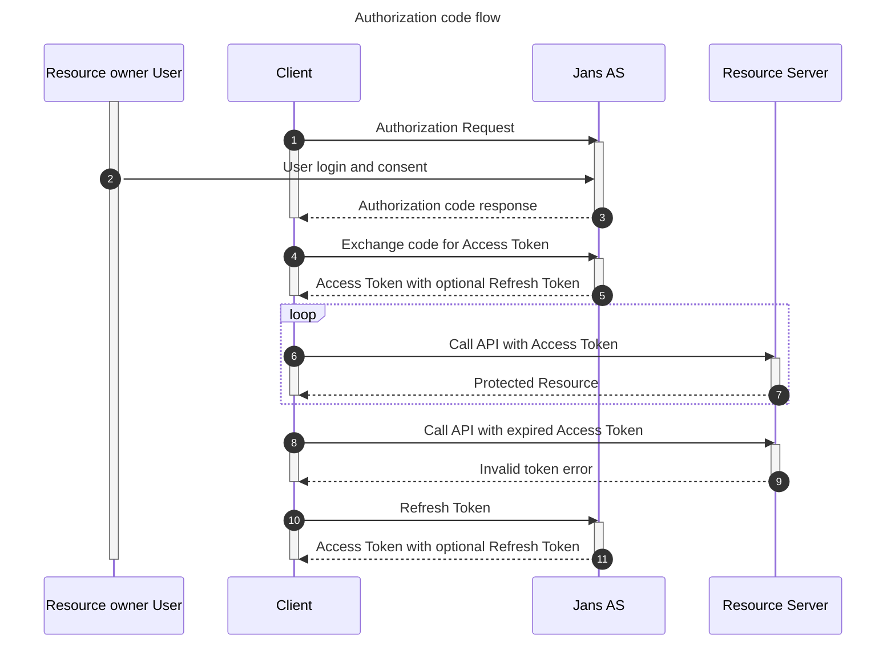

# OAuth 2.0 Authorization Code Grant

The [Authorization Code grant type](https://tools.ietf.org/html/rfc6749#section-1.3.1) is used by confidential and public clients to exchange an authorization code for an access token.
After the user returns to the client via the redirect URL, the application will get the authorization code from the URL and use it to request an access token.

### Sequence Diagram

### Testing

1. https://github.com/JanssenProject/jans/blob/main/jans-auth-server/client/src/test/java/io/jans/as/client/ws/rs/AuthorizationCodeFlowHttpTest.java

2. On a browser access 
`https://my.jans.server/jans-auth/restv1/authorize?redirect_uri=https://my-redirect-app:8080&client_id=Put_client_id_here&scope=username+openid&response_type=code`
Based on the default authentication method set (acr), the user will be presented with credentials for login. The OpenID Provider (Gluu Server) verifies the user’s identity and authenticates the user.
In the back channel the following steps take place :
- The OpenID Provider (Gluu Server) sends the user back to the application with an authorization code.
- The application sends the code to the Token Endpoint to receive an Access Token and ID Token in the response.
- The application uses the ID Token to authorize the user. At this point the application/RP can access the UserInfo endpoint for claims.
