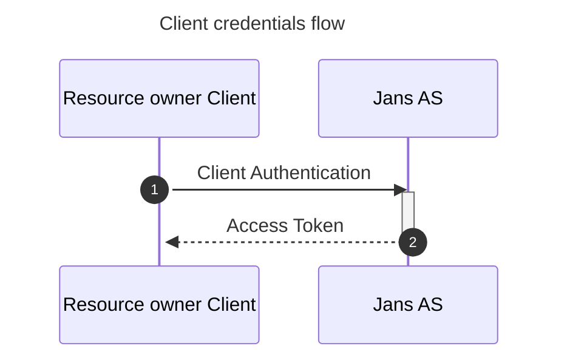

# OAuth 2.0 client credentials Grant

### Sequence Diagram


### Testing

1. https://github.com/JanssenProject/jans/blob/main/jans-auth-server/client/src/test/java/io/jans/as/client/ws/rs/ClientCredentialsGrantHttpTest.java

2. CURL Command:
```
curl -k -u "put_client_id:put_client_secret" https://jans-ui.jans.io/jans-auth/restv1/token \ 
      -d  "grant_type=client_credentials&scope=put_scope_name_here" 
```
