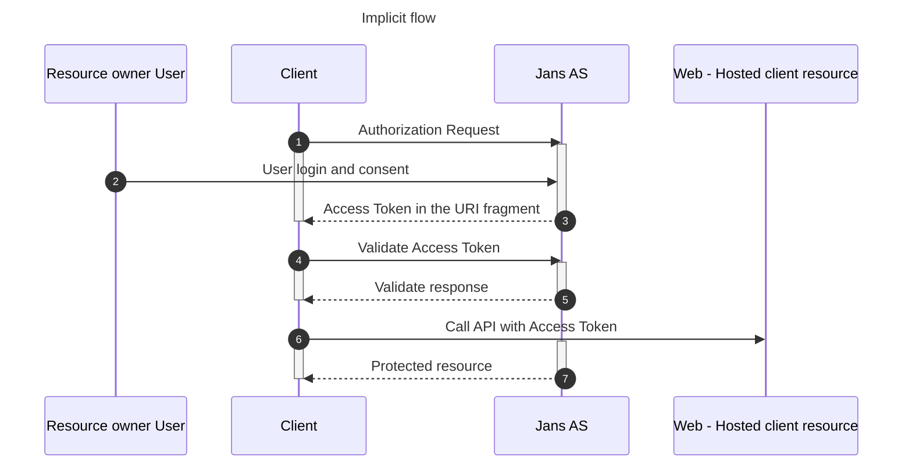

# OAuth 2.0 Implicit Grant

The [Implicit Grant](https://tools.ietf.org/html/rfc6749#section-1.3.2) :

!!! [OAuth 2.0 Security Best Current Practice](https://tools.ietf.org/html/draft-ietf-oauth-security-topics) absolutely discourages the use of Implicit flow.
Instead, use Authorization code flow with PKCE -[OAuth 2.0 for Browser-Based Apps](https://tools.ietf.org/html/draft-ietf-oauth-browser-based-apps).
[Further reading](https://oauth.net/2/grant-types/implicit/)

### Sequence Diagram

